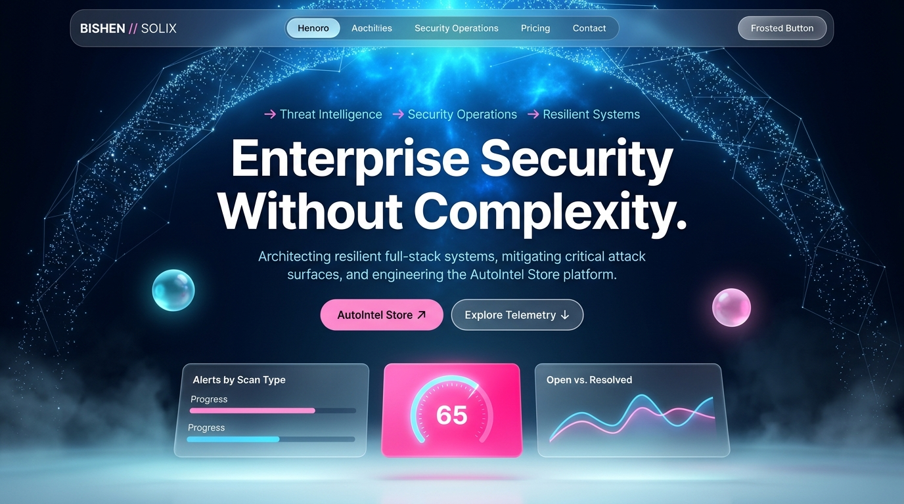
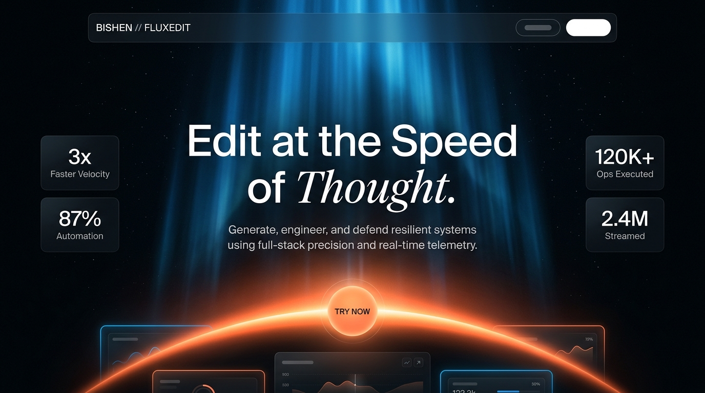
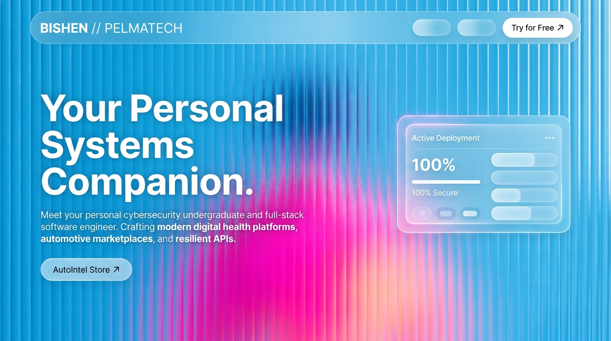

  <!-- ==================== LUXURY WEBSITE HERO ==================== -->
  

    

  <!-- ==================== QUICK ACTION DOCK ==================== -->
  

    
    
    
    
    
    
  

   

  <!-- ==================== THEME PREVIEW DRAWER ==================== -->
  

    
<b>System Designs: Solix · FluxEdit · Pelmatech</b>

     
    

      <b>SOLIX — Deep Royal Blue · Stardust Constellation · Bubblegum Pink</b> 
        
      <b>FLUXEDIT — Midnight Black · Auroral God Rays · Cantaloupe Orange Horizon</b> 
        
      <b>PELMATECH — Sky Blue · Fluted Glass Motion Texture · Radiant Hot Pink</b> 
      
    

  

---

### Technical Stack & Systems Tooling

  

<b>Detailed Arsenal & Capabilities Breakdown</b>

 

| Domain | Core Competencies & Tools |
| :--- | :--- |
| **Security & Systems Defense** | Linux (Kali / Ubuntu), Bash Scripting, Python, Wireshark, Nmap, Network Defense, OWASP Top 10 |
| **Frontend Architecture** | React, Next.js, TypeScript, JavaScript, Tailwind CSS, HTML5 / Semantic UI |
| **Backend & Scalable APIs** | Node.js, Express, RESTful APIs, Secure Authentication (JWT, OAuth 2.0, RBAC) |
| **Database & Persistence** | MySQL, PostgreSQL, Relational Schema Design & Query Optimization |
| **DevOps & Tooling** | Docker, Git, GitHub Actions (CI/CD Workflows), Postman, Linux CLI |

---

### Telemetry & Engineering Metrics

  
  

---

### Contribution Activity

<picture>
  <source media="(prefers-color-scheme: dark)" srcset="https://raw.githubusercontent.com/bishenjayawardhana/bishenjayawardhana/output/github-contribution-grid-snake-dark.svg">
  <source media="(prefers-color-scheme: light)" srcset="https://raw.githubusercontent.com/bishenjayawardhana/bishenjayawardhana/output/github-contribution-grid-snake.svg">
  
</picture>

---

  Engineered by <b><a href="https://github.com/bishenjayawardhana">Bishen Jayawardhana</a></b> • Stay curious & stay secure

