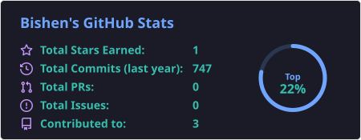
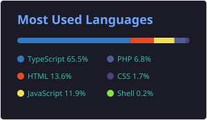

<div align="center">

<br/>

---

###  About Me

```yaml
name: Bishen Jayawardhana
focus: Cyber Security & Full-Stack Engineering
academic:
  year: 2nd Year Undergraduate
  program: BSc in Cyber Security
  institution: NSBM Green University (affiliated with Victoria University, Australia)
mindset: "Don't just write code — understand how it works under the hood and how to defend it."
```

-  **Academics:** Pursuing a Bachelor's in **Cyber Security** at **NSBM Green University** (Affiliated with **Victoria University, Australia**).
-  **Cyber Security Interests:** Network Security, Ethical Hacking, Web Application Security (OWASP Top 10), Penetration Testing & Threat Assessment.
-  **Software Development:** Building modern full-stack web platforms with responsive UI, resilient backends, and clean RESTful APIs.
-  **Current Focus:** Engineering the [AutoIntel Store](https://autointelstore.com) automotive platform and deepening systems security knowledge.
-  **Off-duty:** Tech research, cybersecurity capture-the-flags (CTFs), and curating tracks on [Spotify](https://open.spotify.com/user/31aizozjdk4invcobmpavvn7qaoa).

<br/>

---

###  Tech Stack & Security Arsenal

<br/>

<p align="center">
  <a href="https://skillicons.dev">
    
  </a>
</p>

<br/>

<details>
<summary><b> Detailed Breakdown</b></summary>
<br/>

| Category                            | Technologies & Tools                                                                   |
| :---------------------------------- | :------------------------------------------------------------------------------------- |
|  **Cyber Security & Systems** | Linux (Kali / Ubuntu), Bash Scripting, Python, Wireshark, Nmap, Network Defense, OWASP |
|  **Frontend Engineering**     | React, Next.js, TypeScript, JavaScript, Tailwind CSS, HTML5 / CSS3                     |
|  **Backend & APIs**           | Node.js, Express, RESTful APIs, Secure Authentication (JWT / OAuth)                    |
|  **Databases & Storage**      | MySQL, PostgreSQL                                                                      |
|  **DevOps & Collaboration**   | Docker, Git, GitHub Actions, Postman, Linux CLI                                        |

</details>

<br/>

---

###  GitHub Analytics

<br/>

<p align="center">
  <a href="https://github.com/bishenjayawardhana">
    
  </a>  
  <a href="https://github.com/bishenjayawardhana">
    
  </a>
</p>

<p align="center">
  <a href="https://github.com/bishenjayawardhana">
    
  </a>
</p>

<br/>

---

###  Featured Projects

<br/>

| Project                        | Description                                                                                             | Stack                                          |                        Link                        |
| :----------------------------- | :------------------------------------------------------------------------------------------------------ | :--------------------------------------------- | :------------------------------------------------: |
|  **AutoIntel&nbsp;Store**     | Automotive marketplace & spare parts management ecosystem with interactive catalog and admin dashboard. | `React` `TypeScript` `Node.js` `MySQL` |     [Live&nbsp;Site&nbsp;↗](https://autointelstore.com)     |
|  **Cyber&nbsp;Security&nbsp;Labs** | Practical security labs, vulnerability scanning, network traffic analysis, and CTF challenges.          | `Python` `Bash` `Linux` `Wireshark`    | [Explore&nbsp;↗](https://github.com/bishenjayawardhana) |

<br/>

---

###  Contribution Activity Snake

<div align="center">

---

<div align="center">
  <sub>Designed by <b><a href="https://github.com/bishenjayawardhana">Bishen Jayawardhana</a></b> • Stay curious & stay secure</sub>
</div>
