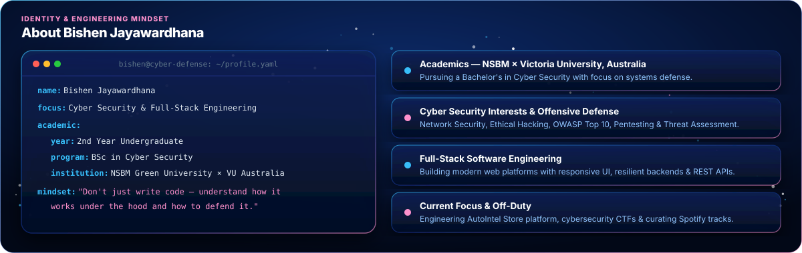
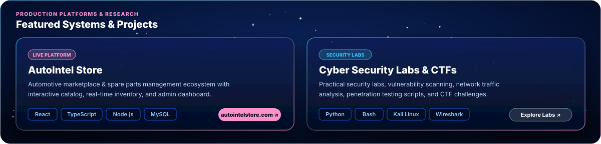
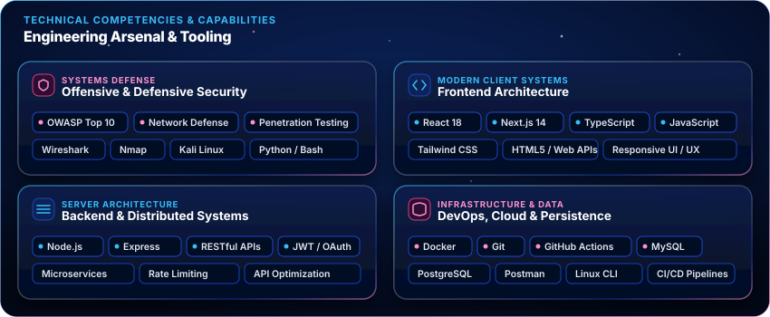
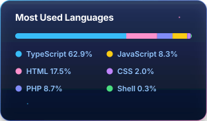
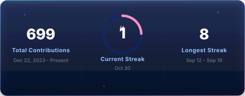
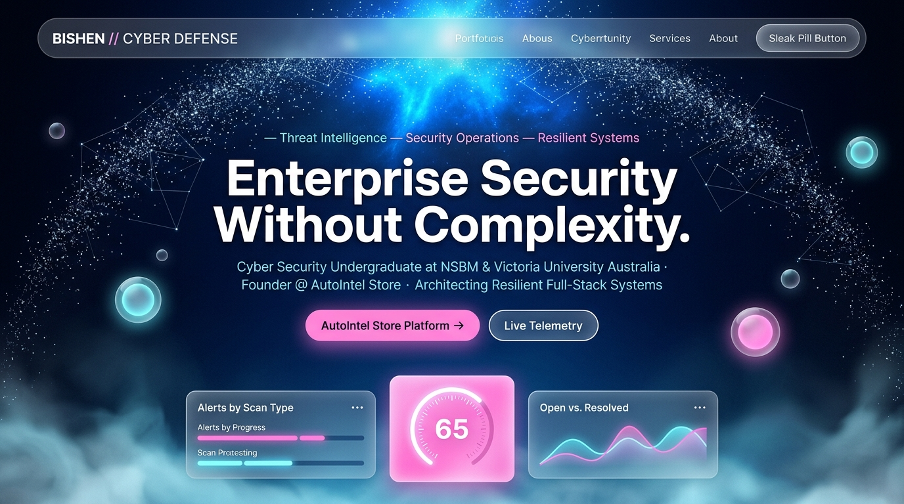
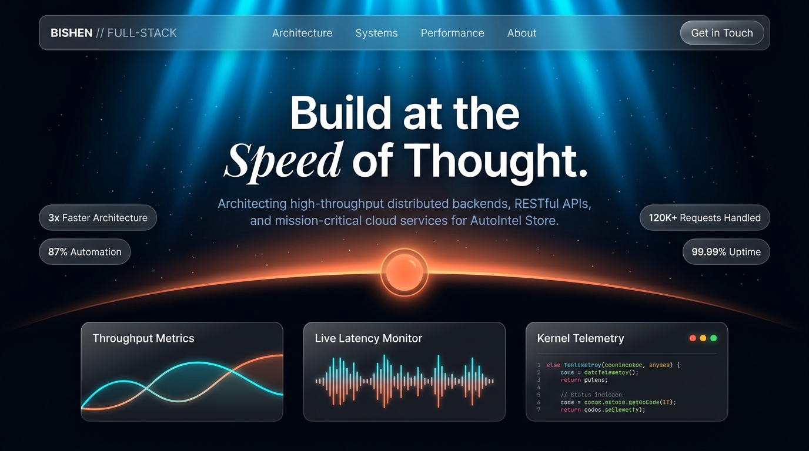
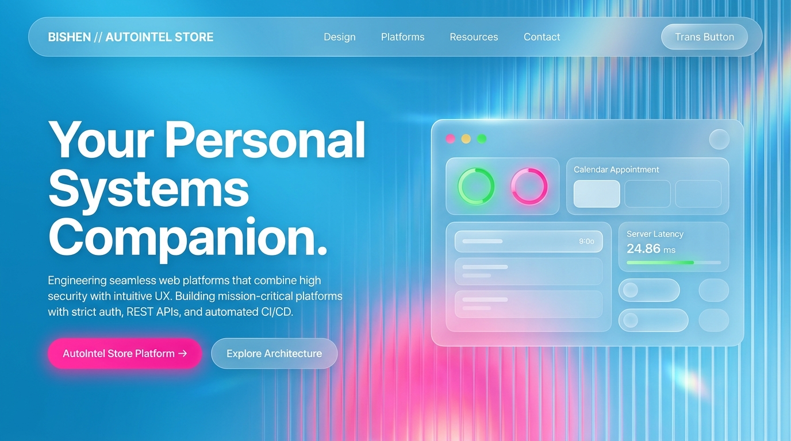

  <!-- ==================== MULTI-THEME CODED GLASS HERO BANNER ==================== -->
  

    

  <!-- ==================== UNIFIED LUXURY ACTION DOCK ==================== -->
  

    
    
    
    
    
    
    
    
  

   

  <!-- ==================== ABOUT ME & ENGINEERING MINDSET (FROSTED BENTO) ==================== -->
  

    

  <!-- ==================== FEATURED SYSTEMS & PROJECTS (FROSTED BENTO) ==================== -->
  

    

  <!-- ==================== TECHNICAL ARSENAL & CAPABILITIES (FROSTED BENTO) ==================== -->
  

    

  

    
  

   

  <!-- ==================== TELEMETRY & GITHUB ANALYTICS (FROSTED BENTO) ==================== -->
  

    
    &nbsp;&nbsp;
    
  

   

  <!-- ==================== CONTRIBUTION ACTIVITY SNAKE ==================== -->
  <picture>
    <source media="(prefers-color-scheme: dark)" srcset="https://raw.githubusercontent.com/bishenjayawardhana/bishenjayawardhana/output/github-contribution-grid-snake-dark.svg">
    <source media="(prefers-color-scheme: light)" srcset="https://raw.githubusercontent.com/bishenjayawardhana/bishenjayawardhana/output/github-contribution-grid-snake.svg">
    
  </picture>

    

  <!-- ==================== HIGH-RES THEME RENDERS DRAWER ==================== -->
  

    
<b>View All 3 High-Resolution Theme Renders</b>

     
    

      <b>Theme 1 — Cyber Security &amp; Systems Defense</b> 
        
      <b>Theme 2 — High-Velocity Distributed Systems</b> 
        
      <b>Theme 3 — Digital Platform Architecture</b> 
      
    

  

   

  <!-- ==================== FOOTER & VIEW TELEMETRY ==================== -->
  

    
  

  Designed &amp; Engineered by <b><a href="https://github.com/bishenjayawardhana">Bishen Jayawardhana</a></b> · Stay curious &amp; stay secure

