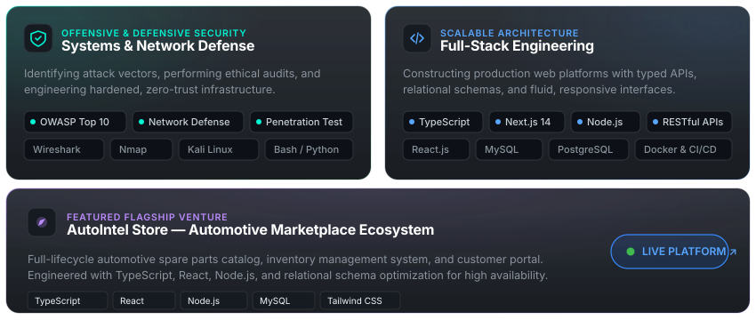

  <!-- ==================== HERO LANDING SECTION ==================== -->
  

    

  <!-- ==================== QUICK CONNECT DOCK ==================== -->
  

    
    
    
    
    
    
  

   

---

### ⚡ Architecture & Systems Capabilities

  

 

---

### 🛠️ Technical Stack & Tooling

  

<b>Detailed Arsenal Breakdown</b>

 

| Domain | Core Competencies & Tools |
| :--- | :--- |
| **Security & Systems Defense** | Linux (Kali / Ubuntu), Bash Scripting, Python, Wireshark, Nmap, Network Defense, OWASP Top 10 |
| **Frontend Architecture** | React, Next.js, TypeScript, JavaScript, Tailwind CSS, HTML5 / Semantic UI |
| **Backend & Scalable APIs** | Node.js, Express, RESTful APIs, Secure Authentication (JWT, OAuth 2.0, RBAC) |
| **Database & Persistence** | MySQL, PostgreSQL, Relational Schema Design & Query Optimization |
| **DevOps & Tooling** | Docker, Git, GitHub Actions (CI/CD Workflows), Postman, Linux CLI |

---

### 📊 Real-Time Telemetry & Engineering Metrics

  
  

  

---

### 🕹️ Contribution Telemetry

<picture>
  <source media="(prefers-color-scheme: dark)" srcset="https://raw.githubusercontent.com/bishenjayawardhana/bishenjayawardhana/output/github-contribution-grid-snake-dark.svg">
  <source media="(prefers-color-scheme: light)" srcset="https://raw.githubusercontent.com/bishenjayawardhana/bishenjayawardhana/output/github-contribution-grid-snake.svg">
  
</picture>

---

  Engineered by <b><a href="https://github.com/bishenjayawardhana">Bishen Jayawardhana</a></b> • Stay curious & stay secure

